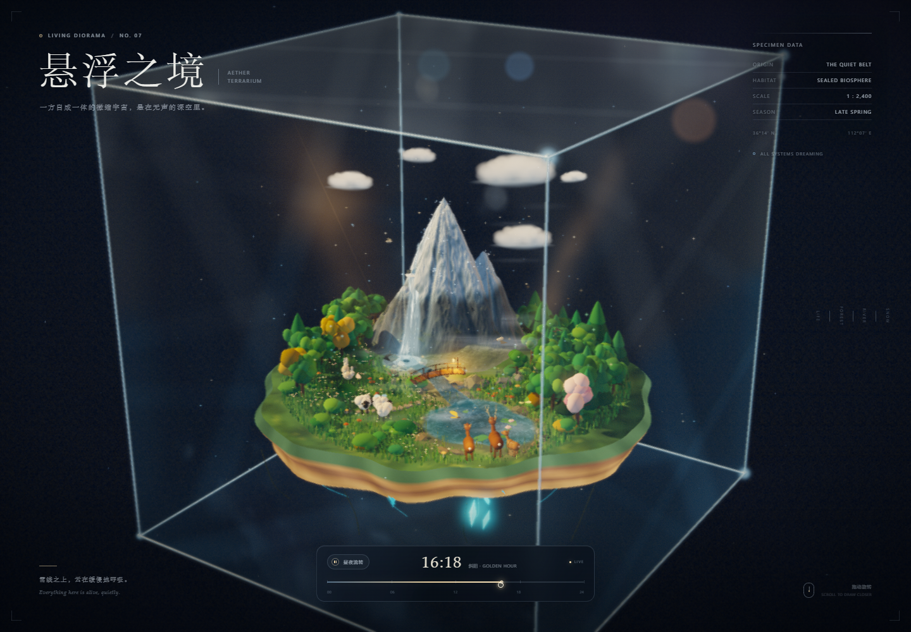

# 悬浮之境 · Aether Terrarium

一方悬浮在深空中的玻璃微缩生态世界。雪山、瀑布、蜿蜒河流、湖泊、森林、草地与微小的生命，在一只透明玻璃立方体中缓慢呼吸。



## 打开方式

直接双击 `index.html` 即可进入，推荐使用最新版 **Chrome / Edge** 并开启硬件加速。

- 全部依赖与贴图均在本地，**无需联网**。
- 如果移动文件夹，请保持 `index.html` 与 `vendor/` 的相对位置不变。
- 个别浏览器若限制 `file://` 下的本地脚本，可在本文件夹内运行：
  ```powershell
  python -m http.server 8080
  ```
  然后访问 `http://localhost:8080`。

## 操作

| 操作 | 效果 |
| --- | --- |
| 拖动 | 绕立方体旋转视角 |
| 滚轮 / 双指缩放 | 靠近或远离 |
| 双击 / `Esc` | 回到初始等距视角 |
| 底部时间轴 | 手动调整一天中的时刻 |
| 左侧“昼夜流转”按钮 | 暂停 / 继续自动昼夜过渡 |

昼夜约 150 秒完成一轮。时间轴拖到深夜时，萤火、薄雾、月光与发光晶体将接管画面。

## 场景内容

- **地形**：程序化漂浮岛，分层土壤、岩壁、根须、微光晶体与不规则浮空底部
- **雪山**：一整块融合的高度场山体，六座主峰与山肩、雪沟、岩脊、坡度与朝向驱动的雪线，以及细碎雪面反光
- **水系统**：雪融瀑布与岩雪源头、动态泡沫与水雾、蜿蜒河流、带深度吸收与真实环境反射的小湖、睡莲与芦苇
- **森林与草地**：90 棵程序化树木、数千株草与花、蕨类林下植被、蘑菇、灌木、枝干与石头
- **微型动物**：鹿与幼鹿、绵羊、兔子、环飞的小鸟、四只蝴蝶，以及桥栏上的一只小鸟
- **天空感**：深空星场、前景散景、五朵柔边悬浮云、地面薄雾、阳光体积光、浮尘与萤火
- **玻璃立方体**：六面菲涅尔玻璃、环境反射、边缘折射色散、移动闪光与倒角玻璃珠
- **摄影感**：基于深度缓冲的微距景深、屏幕移轴、双重 Bloom、halation、ACES 色调映射、分离色调、暗角、色差与胶片颗粒

## 光影与后期

- **主光**：随昼夜迁移的侧逆光；低角度金色时刻、冷色补光、背后轮廓光与水下补光共同塑形。
- **阴影**：PCF Soft Shadow；树冠、山体、桥与石头保留实影，动物与细枝使用接触阴影保持轻量。
- **材质**：雪面使用物理材质 sheen、微粗糙度与闪点；水面使用深度渐变、三层环境反射采样与岸边泡沫；玻璃使用场景立方体环境反射与 RGB 色散。
- **镜头**：27.5° 桌面长焦、轻微俯视等距构图、1.14× 内部超采样与 FXAA；景深以桥与湖面为焦点，向远山与画面边缘柔和衰减。
- **色彩**：ACES 影调、暖高光/冷阴影分离、受控 halation 与颗粒，避免过度虚化与过曝。

## 技术说明

- **Three.js r160**，使用本地经典构建，零构建步骤。
- 所有地形、山体、水面、瀑布、树木、云朵与光效均为程序化生成；没有外部图片或模型资源。
- 自定义 Shader 用于水面、瀑布、玻璃、体积光、粒子与后期。
- 在一次场景捕获中生成立方体环境贴图，供湖水与玻璃反射使用；随时间变化重新着色，保持昼夜一致。
- 使用 InstancedMesh、合批玻璃栏杆、分级画质与移动端像素比上限，兼顾桌面与移动设备的流畅度。
- 桌面 1440×1000、含完整后期的参考开销约为 **438 draw calls / 39 万三角面**；移动端自动降低云层数量、草花密度、阴影尺寸与内部渲染比例。
- 分辨率、相机取景、后期靶面与深度纹理会随窗口变化自动适配。

## 文件结构

```text
glass-terrarium/
├─ index.html           入口页面
├─ styles.css           展览式信息层与响应式布局
├─ app.js               三维场景、交互、动画与后期管线
├─ preview.png          预览图
├─ README.md            说明文档
└─ vendor/
   └─ three.min.js      Three.js r160 本地构建
```

Three.js 依据 MIT License 分发，版权归 Three.js 作者所有。
